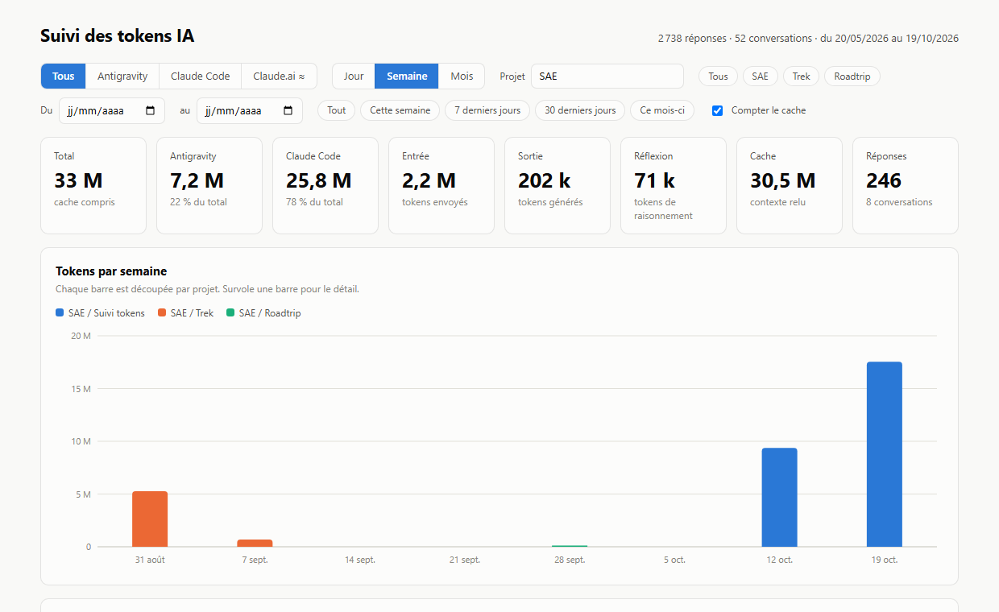

# 📊 Suivi des tokens IA

Un tableau de bord qui montre combien de tokens tu consommes avec **Antigravity** (Gemini), **Claude Code** et **claude.ai**, ainsi que le **quota de ton abonnement Claude**.



> Tout se calcule **en local** sur ton PC, en 1 à 2 secondes. Aucune IA n'est sollicitée, donc ce suivi ne coûte aucun token.

---

## 🚀 Démarrer

| | |
|:---:|---|
| **1** | Installer [Node.js](https://nodejs.org), version **22.5 ou plus récente** (une seule fois). |
| **2** | Double-cliquer sur **`lancer.cmd`**. |
| **3** | La page s'ouvre dans le navigateur. Relance `lancer.cmd` pour la mettre à jour. |

---

## 👀 Ce que montre la page

| Zone | Contenu |
|---|---|
| 🔢 **Chiffres clés** | total, part de chaque outil, entrée, sortie, réflexion, cache, nombre de réponses |
| 📈 **Tokens par période** | une barre par jour, semaine ou mois, découpée par projet (survole pour le détail) |
| ⏱️ **Quota Claude** | % utilisé de ton abonnement : fenêtre de 5 heures et semaine |
| 🏷️ **Par projet / par modèle** | classements avec la part de chacun |
| 📋 **Tableau détaillé** | chiffres par période, avec un bouton **Télécharger en CSV** |

**Filtres :** outil · jour / semaine / mois · projet (raccourcis *SAE*, *Trek*, *Roadtrip*) · dates libres · *Cette semaine*, *7 jours*, *30 jours*, *Ce mois-ci* · cache compté ou non.

---

## 🧩 D'où viennent les chiffres

| Outil | Source | Précision |
|---|---|---|
| **Antigravity** | conversations enregistrées sur le PC | ✅ tokens réels |
| **Claude Code** | sessions enregistrées sur le PC | ✅ tokens réels (identiques à OpenUsage) |
| **Claude.ai** | export de tes conversations (voir ci-dessous) | ≈ estimation |
| **Quota Claude** | relevés de l'appli Claude | ✅ % réel, tous usages compris |

💾 **Rien ne se perd :** chaque lancement complète **`historique-tokens.json`**. Une conversation effacée par l'outil reste comptée.

> ⚠️ Claude Code efface ses sessions au bout de 30 jours. **Lance le suivi au moins une fois par mois**, et ne supprime pas `historique-tokens.json`.

---

## 💬 Ajouter claude.ai

| | |
|:---:|---|
| **1** | Sur claude.ai : **Paramètres › Confidentialité › Exporter les données**. |
| **2** | Télécharge le **`.zip`** reçu par e-mail. |
| **3** | Dépose-le **tel quel** dans le dossier **`exports-claude-ai`**. |
| **4** | Relance `lancer.cmd`. |

Refais un export de temps en temps : les nouvelles conversations s'ajoutent, sans doublon.

<details>
<summary>Comment l'estimation est calculée</summary>

L'export ne contient pas les tokens, seulement le texte. Le script compte environ **3,5 caractères par token** :

- **Entrée** : ton message et le texte de ses pièces jointes.
- **Sortie** : la réponse de Claude.
- **Réflexion** : le raisonnement, s'il figure dans l'export.
- **Cache** : ce qui avait déjà été échangé dans la conversation, relu par Claude à chaque réponse.

Les instructions internes de claude.ai, les images et les recherches web ne sont pas dans l'export : le vrai chiffre est sans doute **plus élevé**.
</details>

---

## ⚙️ Réglages — `config.json`

| Clé | À quoi elle sert |
|---|---|
| `filtreParDefaut` | projet affiché à l'ouverture (`"SAE"`, ou `""` pour tout voir) |
| `raccourcis` | boutons de filtre rapide (`SAE`, `Trek`, `Roadtrip`…) |
| `sousProjets` | ranger les conversations par projet, voir ci-dessous |
| `membre`, `debutSemaine1` | ton prénom et la semaine n°1, pour le tableau d'équipe |
| `dossiersConversations` | conversations Antigravity (`~` = ton dossier utilisateur) |
| `dossiersClaude` | sessions Claude Code (par défaut `~/.claude/projects`) |
| `dossierExportClaudeAi` | où déposer les exports claude.ai |
| `caracteresParToken` | ratio de l'estimation claude.ai (3,5) |

<details>
<summary>Ranger les conversations par sous-projet</summary>

Quand plusieurs projets partagent un dossier (trek et roadtrip dans `BUT3/SAE`), le script lit chaque conversation. Il la range dans le sous-projet dont les mots-clés reviennent le plus souvent.

```json
{ "nom": "SAE / Roadtrip", "dossiers": ["BUT3/SAE", "claude.ai"], "motsCles": ["road.?trip"] }
```

- **`dossiers`** : les dossiers concernés. `"claude.ai"` inclut les conversations claude.ai.
- **`motsCles`** : des expressions régulières, sans distinction de majuscules. `"."` regroupe tout le dossier sous ce nom.
</details>

---

## 📁 Fichiers

| Fichier | Rôle |
|---|---|
| `lancer.cmd` | 👉 **le seul fichier à ouvrir** |
| `suivi_tokens.js` | le script : lecture, calculs, génération de la page |
| `modele_tableau_de_bord.html` | le modèle de la page |
| `config.json` | les réglages |
| `docs/apercu.png` | la capture de ce README |

🔒 `historique-tokens.json`, `tableau-de-bord-tokens.html` et `exports-claude-ai/` contiennent tes données personnelles. Ils sont **exclus de git**.

---

## 📌 Bon à savoir

- **Seul ce PC est compté.** Ce qui a été effacé avant le premier lancement ne peut pas être récupéré.
- **Il n'y a pas de coût en dollars** : Antigravity et claude.ai ne l'enregistrent pas.
- **Le total inclut le cache.** Ce sont des tokens de contexte relus, bien moins chers. Décoche *Compter le cache* pour voir l'effort réel.
- **Le quota n'est relevé que quand l'appli Claude est ouverte.** La courbe est coupée quand elle était fermée.
- **Le format d'Antigravity n'est pas documenté.** Les nombres viennent bien des fichiers, mais le sens exact des colonnes est déduit.
- **Les fichiers des outils ne sont jamais modifiés.** Ils sont seulement lus, sur une copie pour Antigravity.

<details>
<summary>Pour aller plus loin : la ligne de commande</summary>

```powershell
node suivi_tokens.js                                  # tableau de bord (comme lancer.cmd)
node suivi_tokens.js semaine --projet SAE             # tableau texte par semaine
node suivi_tokens.js semaine --colonnes outil         # une colonne par outil
node suivi_tokens.js equipe --projet SAE --sans-cache # lignes pour donnees/consommation.csv
node suivi_tokens.js --aide                           # toutes les vues et options
```
</details>
